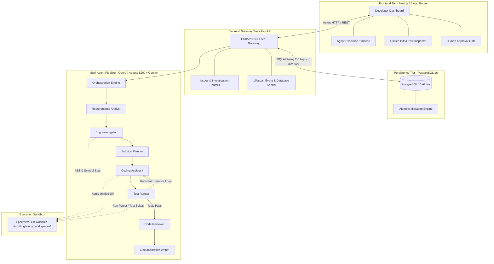

# BugBunny — From GitHub issue to implementation-ready change.

<div align="center">
  
  <p><strong>Autonomous Multi-Agent Software Engineering Assistant</strong></p>
</div>

---

## 1. Product Overview

**BugBunny** is an autonomous, web-based multi-agent software engineering assistant that accelerates the developer workflow from bug ingestion to pull request authoring. A developer selects a GitHub issue, and BugBunny coordinates specialized AI agents to analyze requirements, investigate the codebase symbol graph, formulate an implementation plan, author minimal diffs, execute tests in an isolated sandbox, and generate pull request documentation.

The system is designed with an emphasis on **system grounding**, **verifiable code execution**, and **human-in-the-loop approval gates**, avoiding the common pitfalls of hallucinated code and unverified LLM patches.

---

## 2. Problem Statement

Modern software engineering teams spend a disproportionate share of their time triaging issues, navigating unfamiliar codebases, and writing boilerplate remediation code:

- **Ambiguous Issue Reports**: Issue descriptions often describe user-facing symptoms without linking stack traces, reproduction steps, or the underlying database transactions.
- **Cognitive Overhead in Code Navigation**: Developers spend 40–60% of their debugging time searching symbol hierarchies, call trees, and test suites across large multi-file repositories.
- **Unverified AI Code Generation**: Generic LLMs and chat interfaces frequently hallucinate imports, break existing test suites, and fail to adhere to project idioms because they lack sandboxed execution and iterative feedback.
- **Documentation Drift**: Writing thorough pull request summaries, test coverage deltas, and changelog updates is often skipped or deferred under deadline pressure.

---

## 3. The BugBunny Solution

BugBunny decomposes software remediation into an automated pipeline of specialized, single-responsibility agents:

1. **Structured Ingestion**: Converts free-form issue text into verifiable reproduction criteria.
2. **Context-Constrained Retrieval**: Explores AST symbols, call hierarchies, and test files using targeted tools rather than dumping entire codebases into token windows.
3. **Deterministic Planning**: Synthesizes an atomic, step-by-step diff plan with risk assessments before writing code.
4. **Sandboxed Verification**: Generates unified diffs, applies them inside an isolated Git worktree, and runs real test suites (`pytest`, `npm test`) with an automated self-correction loop.
5. **Human Gate & PR Drafting**: Requires human sign-off on the generated diff and test results before drafting the pull request.

---

## 4. Why This Project Matters (AI Engineering Concepts)

BugBunny is engineered to demonstrate core principles of modern production AI engineering:

- **Multi-Agent Orchestration**: Replaces monolithic prompts with discrete, specialized agents communicating through structured handoffs.
- **Tool Calling & Code Grounding**: Agents utilize deterministic tools (Ripgrep, Tree-sitter AST symbol lookups, test runner runners) to ground reasoning in factual code artifacts.
- **Structured Outputs**: All inter-agent communication and database records use strict Pydantic v2 schemas, eliminating schema drift and parsing failures.
- **Human-in-the-Loop (HITL) Gate**: Autonomous agents cannot merge code or deploy without explicit human approval decisions, ensuring safety and compliance.
- **Persistent Execution Telemetry**: Every agent run, duration, token usage estimate, and output is recorded in PostgreSQL for auditing and evaluation.
- **Sandboxed Execution Boundaries**: Ephemeral Git worktrees prevent untested agent modifications from contaminating the host codebase.
- **Empirical Evaluation Ready**: Designed to support benchmark evaluation datasets (e.g., SWE-bench style test harnesses) to measure first-pass patch success and retrieval recall.

---

## 5. Current Project Status

To ensure complete technical transparency, project capabilities are categorized into their current development status:

| Status Category | Description |
| :--- | :--- |
| 🟢 **Available Now** | Fully implemented, tested, and runnable in the repository. |
| 🟡 **In Development** | Architecture scaffolded; model adapters, agent prompts, and tool integrations in active progress. |
| ⚪ **Planned Roadmap** | Scheduled for future milestones in the engineering roadmap. |

### Feature & Capability Status Matrix

| Component | Status | Implementation Details |
| :--- | :--- | :--- |
| **Frontend Dashboard Shell** | 🟢 Available Now | Next.js 16 App Router, dark-mode developer UI, overview metrics, issues table. |
| **PP-101 Investigation View** | 🟢 Available Now | Multi-stage agent timeline, evidence cards, plan steps, syntax-highlighted diff, test metrics. |
| **FastAPI Backend Gateway** | 🟢 Available Now | Asynchronous REST gateway with Uvicorn, structured Pydantic v2 schemas. |
| **PostgreSQL & SQLAlchemy 2.0** | 🟢 Available Now | Async SQLAlchemy models for `Repository`, `GitHubIssue`, `Investigation`, `AgentRun`, `ApprovalDecision`. |
| **Database Migrations & Seeding**| 🟢 Available Now | Alembic migration setup and automatic seeder for demo repository and issue `PP-101`. |
| **Backend Test Suite** | 🟢 Available Now | 11/11 passing async pytest unit and integration tests with `httpx.AsyncClient`. |
| **Docker Compose Infrastructure**| 🟢 Available Now | Container definitions for PostgreSQL 16 Alpine and multi-service deployment. |
| **OpenAI Agents SDK Adapter** | 🟡 In Development | Orchestrator harness and handoff state machine definitions. |
| **Gemini 1.5 Pro/Flash Integration**| 🟡 In Development | Structured output prompt templates, context retrieval, and model client adapters. |
| **Specialist Agent Execution** | 🟡 In Development | Agent classes drafted; live tool calling and worktree runner integration in progress. |
| **Live GitHub Webhook Ingestion** | ⚪ Planned Roadmap | GitHub App event listeners for `issues.opened` and automated branch creation. |
| **Automated PR Authoring** | ⚪ Planned Roadmap | Automated commit push and GitHub Pull Request draft submission. |
| **SWE-Bench Evaluation Harness** | ⚪ Planned Roadmap | Benchmark suite evaluating retrieval recall, patch accuracy, and inference costs. |

---

## 6. System Architecture



---

## 7. Multi-Agent Workflow Pipeline

```mermaid
flowchart LR
    Issue([GitHub Issue]) --> A1[1. Requirements Analyst]
    A1 -->|Acceptance Criteria| A2[2. Codebase Investigator]
    A2 -->|Minimal Symbol Context| A3[3. Solution Planner]
    A3 -->|Step-by-Step Plan| A4[4. Coding Assistant]
    A4 -->|Unified Diff| A5[5. Testing Agent]
    A5 -->|Pass: Test Metrics| A6[6. Code Reviewer]
    A5 -->|Fail: Error Logs| A4
    A6 -->|Audit Score & Checks| A7[7. Documentation Writer]
    A7 --> Output([Verified PR & Release Notes])
```



### Specialist Agent Personas

1. **Requirements Analysis Agent (`RequirementsAnalystAgent`)**
   - *Status*: 🟡 In Development (Scaffolded with demo data in foundation)
   - *Responsibility*: Ingests raw issue text and comments; outputs structured reproduction steps, expected behavior, and acceptance criteria.
2. **Bug Investigation Agent (`CodeInvestigatorAgent`)**
   - *Status*: 🟡 In Development (Scaffolded with demo data in foundation)
   - *Responsibility*: Explores repository AST symbols, call hierarchies, and test files; produces a bounded context bundle without token bloat.
3. **Solution Planner Agent (`SolutionPlannerAgent`)**
   - *Status*: 🟡 In Development (Scaffolded with demo data in foundation)
   - *Responsibility*: Devises an atomic multi-step plan assessing risk rating (`low`, `medium`, `high`) and specifying regression assertions.
4. **Coding Assistant (`PatchEngineerAgent`)**
   - *Status*: 🟡 In Development (Scaffolded with demo data in foundation)
   - *Responsibility*: Authors clean, idiomatic unified diffs adhering to existing project style.
5. **Testing Agent (`TestRunnerAgent`)**
   - *Status*: 🟡 In Development (Scaffolded with demo data in foundation)
   - *Responsibility*: Applies the diff in an isolated worktree, runs test suites, and routes error logs back to the Coding Assistant (max 3 loops).
6. **Code Reviewer (`CodeReviewerAgent`)**
   - *Status*: 🟡 In Development (Scaffolded with demo data in foundation)
   - *Responsibility*: Audits patches against security guidelines, performance constraints, and architectural standards.
7. **Documentation Writer (`DocGeneratorAgent`)**
   - *Status*: 🟡 In Development (Scaffolded with demo data in foundation)
   - *Responsibility*: Generates pull request titles, summaries, and changelog entries derived directly from verified test outcomes.

---

## 8. Technology Stack

| Technology | Layer | Purpose |
| :--- | :--- | :--- |
| **Next.js 16 (App Router)** | Frontend | React 19 server/client components, static page generation, and responsive routing. |
| **TypeScript** | Frontend | Strict static typing and interface alignment with backend Pydantic schemas. |
| **Tailwind CSS v4** | Frontend | High-density dark-mode styling with accessible contrast and restrained motion. |
| **FastAPI** | Backend | High-throughput asynchronous REST gateway and OpenAPI documentation generator. |
| **Python 3.11+** | Backend | Core backend runtime, asynchronous event loop, and agent orchestration. |
| **PostgreSQL 16** | Database | Relational storage for repositories, issues, investigations, and agent run telemetry. |
| **SQLAlchemy 2.0 (Async)**| Backend ORM | Asynchronous object-relational mapping utilizing the `asyncpg` driver. |
| **Alembic** | Migrations | Version-controlled database schema management and migration execution. |
| **Docker & Compose** | Infrastructure | Containerized PostgreSQL and multi-service deployment orchestration. |
| **OpenAI Agents SDK** | Orchestration | Multi-agent coordination, agent handoffs, and state machine transitions *(In progress)*. |
| **Gemini 1.5 Pro / Flash** | Reasoning Provider | Long-context codebase reasoning and rapid structured extraction *(In progress)*. |
| **GitHub REST / GraphQL** | External API | Repository synchronization, webhook ingestion, and PR authoring *(Planned)*. |

---

## 9. Repository Structure

```text
BugBunny/
├── frontend/                   # Next.js 16 App Router application
│   ├── src/
│   │   ├── app/                # Route handlers, layouts, and page views
│   │   │   ├── page.tsx        # Overview dashboard
│   │   │   └── issues/         # Issue table and investigation detail routes
│   │   ├── components/         # Reusable UI components (Navbar, BugBunnyLogo)
│   │   └── mock/               # Seeded demonstration data fixtures
│   ├── public/                 # Static branding assets
│   ├── Dockerfile              # Multi-stage production container definition
│   └── package.json            # Node.js dependencies and scripts
│
├── backend/                    # Python FastAPI service
│   ├── alembic/                # Database migrations (versions and environment)
│   ├── app/
│   │   ├── main.py             # FastAPI entrypoint, middleware, and lifespan handler
│   │   ├── core/               # Configuration, database engine, and seeders
│   │   ├── models/             # SQLAlchemy declarative entities
│   │   ├── schemas/            # Pydantic v2 request/response models
│   │   ├── api/                # Versioned REST route controllers
│   │   ├── agents/             # Agent orchestrator and specialist modules
│   │   └── services/           # Workspace sandbox isolation and GitHub service
│   ├── tests/                  # Pytest async unit and integration tests
│   ├── Dockerfile              # Multi-stage Python 3.12-slim production container
│   ├── requirements.txt        # Python dependency manifest
│   └── pyproject.toml          # Tooling configuration (pytest, ruff)
│
├── infra/                      # Infrastructure configurations
│   └── docker-compose.yml      # Standalone PostgreSQL 16 Compose definition
│
├── docs/                       # Project and technical documentation
│   ├── project-brief.md        # Problem statement, objectives, and success criteria
│   ├── architecture.md         # Detailed architectural and pipeline specification
│   ├── development.md          # Local developer setup, testing, and migration guide
│   ├── api.md                  # Complete REST API reference and schema definitions
│   ├── roadmap.md              # 9-milestone engineering roadmap
│   └── github-metadata.md      # Repository topics and discoverability guide
│
├── docker-compose.yml          # Root multi-tier Compose specification
├── .env.example                # Sanitized environment variable template
├── CONTRIBUTING.md             # Contribution guidelines and standards
├── SECURITY.md                 # Security policy and vulnerability disclosure
├── CODE_OF_CONDUCT.md          # Contributor Covenant v2.1
├── LICENSE                     # MIT License
└── README.md                   # This document
```

---

## 10. Local Setup & Quickstart

### 1. Prerequisites
- **Git** 2.30+
- **Python** 3.11+ (Python 3.12 recommended)
- **Node.js** 20+ (with npm)
- **Docker & Docker Compose** (for PostgreSQL)

### 2. Environment Setup
Copy the environment template:
```bash
cp .env.example .env
```
The default credentials in `.env.example` are pre-configured for local development.

### 3. Start Database (PostgreSQL)
Launch the PostgreSQL 16 container:
```bash
docker compose -f infra/docker-compose.yml up -d
```
Verify the container is healthy:
```bash
docker compose -f infra/docker-compose.yml ps
```

### 4. Run Backend Service (FastAPI)
```bash
cd backend
python3 -m venv .venv
source .venv/bin/activate
pip install -r requirements.txt
uvicorn app.main:app --host 0.0.0.0 --port 8000 --reload
```
On startup, the backend automatically initializes tables and seeds the demo issue (`PP-101`).
- **Health Check**: [http://localhost:8000/health](http://localhost:8000/health)
- **Interactive Swagger Docs**: [http://localhost:8000/docs](http://localhost:8000/docs)
- **Issues API**: [http://localhost:8000/api/issues](http://localhost:8000/api/issues)

### 5. Run Frontend Application (Next.js)
In a separate terminal:
```bash
cd frontend
npm install
npm run dev
```
Open [http://localhost:3000](http://localhost:3000) to view the BugBunny dashboard.

---

## 11. Automated Testing & Verification

Execute all quality checks across the monorepo:

```bash
# 1. Run backend asynchronous tests (11 passing tests)
./backend/.venv/bin/pytest backend/tests -v

# 2. Run backend Ruff linter
./backend/.venv/bin/ruff check backend

# 3. Run frontend ESLint
cd frontend && npm run lint

# 4. Run frontend production build (verifies TypeScript types & routes)
cd frontend && npm run build

# 5. Validate Docker Compose configuration
docker compose config
```

---

## 12. API Documentation

Interactive API documentation is generated automatically by FastAPI:
- **Swagger UI**: [http://localhost:8000/docs](http://localhost:8000/docs)
- **ReDoc UI**: [http://localhost:8000/redoc](http://localhost:8000/redoc)
- **Detailed Schema Specification**: See [docs/api.md](docs/api.md).

---

## 13. Development Workflow

- **Branching**: Branch from `main` using descriptive prefixes (`feat/`, `fix/`, `docs/`, `refactor/`).
- **Commits**: Follow the [Conventional Commits](https://www.conventionalcommits.org/) standard (`feat(scope): description`).
- **Quality Gates**: All PRs must pass `pytest`, `ruff`, `eslint`, and `npm run build` before merge.
- **Review**: Pull requests require at least one maintainer review before merging.

For full details, review [CONTRIBUTING.md](CONTRIBUTING.md).

---

## 14. Security Policy & Practices

- **Zero Committed Secrets**: API tokens, private keys, and passwords must never be committed. All configuration is loaded from environment variables.
- **Server-Side Execution**: All model invocations and tool operations execute strictly within the backend service; client applications never access provider keys.
- **Human Approval**: Critical operations (applying diffs to production branches, merging PRs) require explicit human sign-off (`ApprovalDecision`).
- **Sandbox Isolation**: Automated tests execute inside isolated ephemeral Git worktrees to prevent host workspace contamination.
- **Vulnerability Reporting**: See [SECURITY.md](SECURITY.md) for our responsible disclosure process.

---

## 15. Engineering Roadmap Summary

- [x] **Milestone 1: Foundation** — Monorepo setup, Next.js, FastAPI, PostgreSQL, Alembic, async tests.
- [x] **Milestone 2: Domain Models & Seeder** — Repositories, issues, investigations, runs, and approval entities.
- [x] **Milestone 3: Issue Dashboard UI** — GitHub-style dark theme, overview, issue table, investigation view.
- [ ] **Milestone 4: Agents SDK & Gemini Adapter** — Orchestration engine, Gemini provider adapter, structured schemas.
- [ ] **Milestone 5: Specialist Agent Pipeline** — 7 specialist agents, iterative test feedback loop.
- [ ] **Milestone 6: GitHub Integration** — Webhook ingestion, automated branch authoring, PR drafting.
- [ ] **Milestone 7: Empirical Evaluation** — SWE-bench style benchmark dataset, retrieval recall, patch accuracy.
- [ ] **Milestone 8: Production Deployment** — Containerized multi-cloud deployment with monitoring.
- [ ] **Milestone 9: Technical Demo & Walkthrough** — Video demonstration and technical presentation.

For detailed milestone breakdowns, see [docs/roadmap.md](docs/roadmap.md).

---

## 16. Portfolio Highlights (For Technical Recruiters & Hiring Managers)

- **End-to-End System Architecture**: Built as a production-structured monorepo featuring an asynchronous Python (FastAPI/SQLAlchemy 2.0) backend, PostgreSQL persistence, and a responsive Next.js 16 App Router frontend.
- **Modern AI Engineering Design**: Implements multi-agent role decomposition, tool grounding (AST symbol retrieval, sandboxed test execution), and structured Pydantic outputs rather than fragile monolithic prompts.
- **Enterprise Security Boundaries**: Enforces zero-committed secrets, strict server-side model isolation, ephemeral Git worktree execution, and a mandatory human approval decision gate.
- **Production Code Quality**: Features 100% passing asynchronous test suites, strict linting (`ruff`, `eslint`), versioned Alembic migrations, and modular API contracts.
- **Transparent Engineering Integrity**: Clearly demarcates implemented foundations from planned roadmap items with realistic technical specifications and zero exaggerated claims.

---

## 17. Community & Contributing

Contributions, bug reports, and feature proposals are welcome!
- **Contributing Guide**: [CONTRIBUTING.md](CONTRIBUTING.md)
- **Code of Conduct**: [CODE_OF_CONDUCT.md](CODE_OF_CONDUCT.md)
- **Issue Tracker**: [GitHub Issues](https://github.com/ynsh-ai/BugBunny/issues)

---

## 18. License

This project is licensed under the [MIT License](LICENSE).
