# PatchPilot AI

> **From GitHub issue to implementation-ready change.**

PatchPilot AI is an autonomous, web-based multi-agent software engineering assistant. A developer selects a GitHub issue, and the system coordinates specialized agents to analyze requirements, investigate the codebase, propose an implementation plan, run tests, review the change, and generate documentation.

Orchestrated using the **OpenAI Agents SDK** and powered by **Gemini** for multi-file codebase reasoning.

---

## 🌟 Architecture Overview

```mermaid
flowchart LR
    Issue([GitHub Issue]) --> Analyst[1. Requirements Analyst]
    Analyst --> Investigator[2. Codebase Investigator]
    Investigator --> Planner[3. Solution Planner]
    Planner --> Engineer[4. Patch Engineer]
    Engineer --> Tester[5. Test Runner]
    Tester -->|Tests Pass| Reviewer[6. Reviewer & Docs]
    Tester -->|Tests Fail| Engineer
    Reviewer --> PR([Verified Pull Request])
```



1. **Requirements Analyst**: Extracts reproduction steps and explicit acceptance criteria from issue descriptions.
2. **Codebase Investigator**: Traverses AST symbols, call hierarchies, and test suites to locate relevant files.
3. **Solution Planner**: Formulates a deterministic, safe, step-by-step implementation plan.
4. **Patch Engineer**: Generates minimal, idiomatic unified diffs matching repository conventions.
5. **Test Runner**: Runs unit and regression test suites in an isolated sandbox to detect regressions.
6. **Code Reviewer & Documenter**: Validates security, writes release notes, and drafts the pull request.

---

## 📁 Monorepo Structure

```text
patchpilot-ai/
├── frontend/               # Next.js 16 App Router, TypeScript, Tailwind CSS, Lucide icons
├── backend/                # Python 3.11+ FastAPI application & agent orchestration
│   ├── alembic/            # Database migration configuration
│   ├── app/                # Application core, models, schemas, routes, agents, services
│   └── tests/              # Pytest async test suite
├── infra/                  # Docker Compose configuration for PostgreSQL 16
├── docs/                   # Architecture and developer documentation
│   ├── architecture.md     # In-depth architectural specification & agent designs
│   └── development.md      # Local development and testing guide
├── .env.example            # Monorepo environment variable template (no real secrets)
├── .gitignore              # Multi-stack gitignore rules
└── README.md               # Project documentation
```

---

## 🚀 Quickstart Guide

### 1. Prerequisites
- **Node.js**: v18.18.0+ (v20+ recommended)
- **Python**: 3.11+
- **Docker & Docker Compose**: v2.20+

### 2. Environment Setup
Copy the environment template:
```bash
cp .env.example .env
```

### 3. Start Database (PostgreSQL)
```bash
docker compose -f infra/docker-compose.yml up -d
```
The database will be healthy and listening on `localhost:5432`.

### 4. Run Backend (FastAPI)
The backend is completely independently runnable:
```bash
cd backend
python3 -m venv .venv
source .venv/bin/activate
pip install -r requirements.txt
uvicorn app.main:app --host 0.0.0.0 --port 8000 --reload
```
- Direct Health Check: [http://localhost:8000/health](http://localhost:8000/health)
- Swagger API Docs: [http://localhost:8000/docs](http://localhost:8000/docs)
- ReDoc API Docs: [http://localhost:8000/redoc](http://localhost:8000/redoc)

### 5. Run Frontend (Next.js)
The frontend is completely independently runnable:
```bash
cd frontend
npm install
npm run dev
```
Open [http://localhost:3000](http://localhost:3000) to view the landing page and simulated multi-agent pipeline visualizer.

---

## 🧪 Verification & Setup Checks

Execute the automated test suites and quality checks across the monorepo:

```bash
# 1. Backend async tests (5/5 passing)
./backend/.venv/bin/pytest backend/tests -v

# 2. Backend Ruff linter
./backend/.venv/bin/ruff check backend

# 3. Frontend ESLint
cd frontend && npm run lint

# 4. Frontend production build
cd frontend && npm run build

# 5. Docker Compose config validation
docker compose -f infra/docker-compose.yml config
```

---

## 🛠️ Technology Stack

| Domain | Technology | Purpose |
| :--- | :--- | :--- |
| **Frontend** | Next.js 16 (App Router), React 19, TypeScript | Real-time agent visualizer & developer review UI |
| **Styling** | Tailwind CSS v4, Lucide React | Curated modern dark-mode aesthetic & iconography |
| **Backend** | FastAPI, Uvicorn, Pydantic v2 | High-performance asynchronous API gateway |
| **Orchestrator** | OpenAI Agents SDK *(Ready)* | Multi-agent coordination and handoff control |
| **Model Provider** | Google Gemini *(Ready)* | Deep context reasoning and codebase analysis |
| **Persistence** | PostgreSQL 16 Alpine, SQLAlchemy 2.0 | Entity, trace, and patch persistence |
| **Migrations** | Alembic | Version-controlled schema migrations |
| **Infrastructure**| Docker Compose | Containerized PostgreSQL with health probing |

---

## 📖 Further Reading

- [Architecture Specification](docs/architecture.md)
- [Local Development Guide](docs/development.md)

---

## 📄 License

MIT
