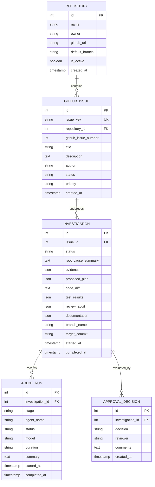

# BugBunny — System Architecture Specification

## 1. System Overview

**BugBunny** is an autonomous, web-based multi-agent software engineering platform. It transforms GitHub issues into verified, implementation-ready code changes with minimal developer overhead.

The platform is designed around strict separation of concerns across three core architectural tiers:
1. **Frontend Tier (Presentation & Interaction)**: Next.js 16 App Router interface providing high-density developer observability, real-time investigation progress, interactive unified diff review, and approval controls.
2. **Backend Gateway Tier (API & Orchestration)**: FastAPI asynchronous service coordinating request routing, database lifecycles, and agent orchestration.
3. **Data & Execution Tier (Persistence & Sandboxing)**: PostgreSQL 16 persistence for issue metadata and run telemetry, coupled with ephemeral Git worktrees for isolated test execution.

---

## 2. High-Level Architecture Diagram

```mermaid
flowchart TD
    subgraph ClientLayer [Client & Developer Interface]
        Dev([Developer / Maintainer]) -->|Browse & Review| UI[Next.js 16 App Router UI]
        GH[GitHub Webhooks] -.->|Issue Events (Planned)| BE
    end

    subgraph GatewayLayer [API & Orchestration Gateway]
        UI -->|REST / Async JSON| BE[FastAPI Backend Gateway]
        BE --> Auth[CORS & Security Middleware]
        BE --> Lifespan[Database Session & Seeder]
    end

    subgraph DataLayer [Persistence Tier]
        BE <-->|SQLAlchemy 2.0 / asyncpg| DB[(PostgreSQL 16)]
        ALEMBIC[Alembic Migrations] --> DB
    end

    subgraph AgentPipeline [Multi-Agent Pipeline (OpenAI Agents SDK + Gemini)]
        BE --> ORCH[Orchestration Coordinator]
        ORCH --> A1[1. Requirements Analysis Agent]
        A1 --> A2[2. Bug Investigation Agent]
        A2 --> A3[3. Solution Planner Agent]
        A3 --> A4[4. Coding Assistant]
        A4 --> A5[5. Testing Agent]
        A5 -->|Tests Fail (max 3 loops)| A4
        A5 -->|Tests Pass| A6[6. Code Reviewer]
        A6 --> A7[7. Documentation Writer]
        A7 --> PRDraft[PR Draft & Changelog]
    end

    subgraph ExecutionSandbox [Isolated Execution Sandbox]
        A2 -.->|AST & Symbol Search| WORKTREE[Ephemeral Git Worktree /tmp/bugbunny_workspaces/]
        A4 -.->|Apply Unified Diff| WORKTREE
        A5 -.->|Run Pytest / Test Suites| WORKTREE
    end

    PRDraft --> HumanGate{Developer Approval Decision}
    HumanGate -->|Approved| GHPR([Ready for Merge])
    HumanGate -->|Rejected| Feedback[Feedback Loop]
```

---

## 3. Multi-Agent Pipeline & Specialist Personas

The multi-agent architecture decomposes complex software engineering tasks into discrete, specialist agents with well-defined contracts and validation schemas:

```mermaid
flowchart LR
    Issue([GitHub Issue]) --> A1[1. Requirements Analyst]
    A1 -->|Acceptance Criteria| A2[2. Codebase Investigator]
    A2 -->|Symbol Graph Bundle| A3[3. Solution Planner]
    A3 -->|Step-by-Step Plan| A4[4. Coding Assistant]
    A4 -->|Unified Diff| A5[5. Testing Agent]
    A5 -->|Pass: Test Metrics| A6[6. Code Reviewer]
    A5 -->|Fail: Error Logs| A4
    A6 -->|Audit Score & Checks| A7[7. Documentation Writer]
    A7 --> Output([Verified PR & Release Notes])
```



### 3.1 Requirements Analysis Agent (`RequirementsAnalystAgent`)
- **Status**: :arrows_counterclockwise: In Development (Mocked in demo data)
- **Role**: Parses raw issue titles, markdown descriptions, reproduction steps, and discussion threads.
- **Tools**: Markdown parser, acceptance criteria extractor.
- **Contract**: Produces a structured specification identifying explicit expected vs. actual behavior, reproduction triggers, and scope boundaries.

### 3.2 Bug Investigation Agent (`CodeInvestigatorAgent`)
- **Status**: :arrows_counterclockwise: In Development (Mocked in demo data)
- **Role**: Explores the target codebase to pinpoint the root cause without blowing up context windows.
- **Tools**: Tree-sitter AST symbol extractor, Ripgrep file search, call graph analyzer.
- **Contract**: Produces a minimal context bundle containing only the specific files, classes, methods, and line spans required to understand the defect.

### 3.3 Solution Planner Agent (`SolutionPlannerAgent`)
- **Status**: :arrows_counterclockwise: In Development (Mocked in demo data)
- **Role**: Synthesizes the requirements and codebase context into a safe, atomic implementation plan.
- **Tools**: Plan generator, dependency graph checker.
- **Contract**: Emits step-by-step diff operations with explicit risk ratings (`low`, `medium`, `high`) and designated test validation assertions.

### 3.4 Coding Assistant (`PatchEngineerAgent`)
- **Status**: :arrows_counterclockwise: In Development (Mocked in demo data)
- **Role**: Authors minimal, clean, idiomatic code modifications adhering to the target repository's existing code style.
- **Tools**: Patch synthesizer, formatter, linter.
- **Contract**: Emits standard unified diff (`git diff`) patches.

### 3.5 Testing Agent (`TestRunnerAgent`)
- **Status**: :arrows_counterclockwise: In Development (Mocked in demo data)
- **Role**: Executes existing test suites and generated regression tests in an isolated ephemeral worktree.
- **Feedback Loop**: If tests fail, error output, stack traces, and test names are routed back to the **Coding Assistant** (capped at 3 iterative attempts) for self-correction.
- **Contract**: Emits structured test results (passed, failed, duration, test coverage delta).

### 3.6 Code Reviewer (`CodeReviewerAgent`)
- **Status**: :arrows_counterclockwise: In Development (Mocked in demo data)
- **Role**: Conducts automated architectural, performance, and OWASP security audits on the generated diff.
- **Contract**: Produces a review audit score (0-100), pass/fail check items, and remediation notes.

### 3.7 Documentation Writer (`DocGeneratorAgent`)
- **Status**: :arrows_counterclockwise: In Development (Mocked in demo data)
- **Role**: Authors user-facing pull request titles, summaries, changelog entries, and migration guides derived directly from test validation.
- **Contract**: Produces a complete pull request markdown body.

---

## 4. Sandbox Isolation & Workspace Execution Model

Security and immutability are primary architectural constraints. Agent code execution is isolated using ephemeral workspaces:

1. **Host Immutability**: The primary working directory is never mutated directly during agent reasoning.
2. **Isolated Worktrees**: When an investigation starts, a detached Git worktree is spawned in `/tmp/bugbunny_workspaces/{investigation_id}`:
   ```bash
   git worktree add /tmp/bugbunny_workspaces/inv-101 -b bugbunny/pp-101-investigation HEAD
   ```
3. **Execution Boundaries**: The **Testing Agent** runs test runners (`pytest`, `npm test`) inside this ephemeral directory. Network access is restricted to package cache mirrors.
4. **Cleanup**: Upon investigation completion, worktrees are pruned, leaving only the stored diff and database telemetry records.

---

## 5. Domain Models & Database Schema

BugBunny models the software remediation lifecycle through five core entities in PostgreSQL:



---

## 6. Implementation Status Matrix

| Component / Layer | Implementation Status | Notes |
| :--- | :--- | :--- |
| **Frontend Shell & Layout** | :white_check_mark: Available Now | Next.js 16 App Router, dark theme, responsive navigation |
| **Issue List & Detail Pages** | :white_check_mark: Available Now | `/` overview, `/issues` table, `/issues/PP-101` investigation view |
| **Backend API Gateway** | :white_check_mark: Available Now | FastAPI, `/health`, `/api/issues`, `/api/investigations` |
| **Database & Migrations** | :white_check_mark: Available Now | PostgreSQL 16, SQLAlchemy 2.0 async, Alembic initial migration |
| **Database Seeder & Demo Data** | :white_check_mark: Available Now | Seeds `demo-ecommerce-app` and issue `PP-101` with full pipeline trace |
| **Unit & Integration Tests** | :white_check_mark: Available Now | 11/11 async pytest tests passing for health, issues, investigations |
| **OpenAI Agents SDK Adapter** | :arrows_counterclockwise: In Development | Handoff coordinator architecture scaffolded |
| **Gemini Model Provider** | :arrows_counterclockwise: In Development | Prompt templates and structured output schemas drafted |
| **Live Multi-Agent Execution** | :arrows_counterclockwise: In Development | Specialist classes drafted; live tool calling in progress |
| **Live GitHub Webhooks & Apps** | :white_circle: Planned Roadmap | Scheduled for Milestone 6 |
| **Empirical Evaluation Benchmark**| :white_circle: Planned Roadmap | Scheduled for Milestone 7 |
