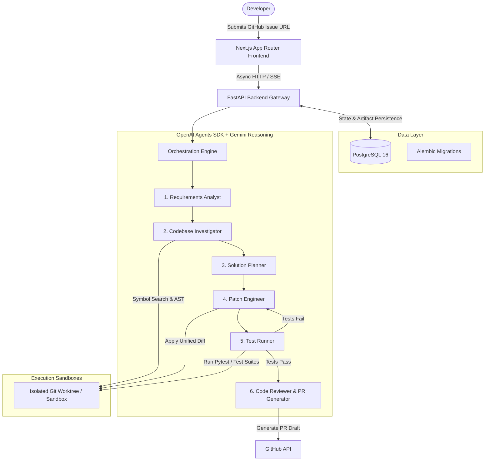

# BugBunny — Architecture Specification

## 1. Executive Overview

**BugBunny** is an autonomous, web-based multi-agent software engineering platform. It transforms GitHub issues into verified, implementation-ready code changes with minimal developer overhead.

When a developer selects or inputs a GitHub issue URL, BugBunny launches an orchestrated pipeline of specialized AI agents. These agents analyze the requirements, inspect the repository symbol graph, synthesize an atomic implementation plan, generate the patch, execute unit and regression test suites in an isolated sandbox, and draft pull request documentation.



---

## 2. Monorepo Structure

```text
bugbunny/
├── frontend/                # Next.js 16 (App Router), TypeScript, Tailwind CSS
│   ├── src/
│   │   └── app/             # Application routes, layouts, and page views
│   ├── public/              # Static assets and icons
│   └── package.json
│
├── backend/                 # Python 3.11+ FastAPI application
│   ├── alembic/             # Database migration configuration & scripts
│   ├── app/
│   │   ├── main.py          # FastAPI application entrypoint & middleware
│   │   ├── core/            # Configuration & async SQLAlchemy database session
│   │   ├── models/          # Declarative database entities
│   │   ├── schemas/         # Pydantic request/response validation schemas
│   │   ├── api/             # REST endpoints (health, issues, agent runs)
│   │   ├── agents/          # Multi-agent orchestrator & specialist agents
│   │   └── services/        # GitHub API client & workspace sandbox isolation
│   ├── tests/               # Pytest async test suite
│   ├── requirements.txt
│   └── pyproject.toml
│
├── infra/                   # Infrastructure configuration
│   └── docker-compose.yml   # PostgreSQL 16 container definition
│
├── docs/                    # System & development documentation
│   ├── architecture.md      # This document
│   └── development.md       # Local setup, workflow, and testing guide
│
├── .env.example             # Monorepo environment variable template
├── .gitignore               # Multi-ecosystem ignore rules
└── README.md                # Quickstart and project overview
```

---

## 3. Multi-Agent Pipeline & Persona Specifications

The core engine utilizes the **OpenAI Agents SDK** for orchestration, backed by **Gemini** as the primary reasoning model provider. Work is partitioned across 6 distinct agent personas:

### 3.1 Requirements Analyst (`RequirementsAnalystAgent`)
- **Role**: Parses issue title, Markdown description, labels, and discussion comments.
- **Output**: Structured requirement specification detailing:
  - Exact reproduction steps
  - Expected behavior vs. actual behavior
  - Criteria of satisfaction (acceptance criteria)
  - Scope boundaries (explicit out-of-scope declarations)

### 3.2 Codebase Investigator (`CodeInvestigatorAgent`)
- **Role**: Locates source files, symbol declarations, call trees, and existing test suites related to the problem.
- **Tools**: Ripgrep, AST symbol extraction, file viewers, and call graph analyzers.
- **Output**: Curated context bundle containing only the minimal set of files and symbol spans necessary to formulate the solution.

### 3.3 Solution Planner (`SolutionPlannerAgent`)
- **Role**: Synthesizes the requirements and codebase context into a deterministic, non-destructive implementation plan.
- **Output**: Step-by-step diff plan, risk assessment, and validation strategy specifying which tests must pass.

### 3.4 Patch Engineer (`PatchEngineerAgent`)
- **Role**: Implements the plan by authoring minimal, clean code diffs adhering to the existing codebase's formatting and style idioms.
- **Output**: Standard unified diff (`git diff`) applying atomic modifications.

### 3.5 Test Runner (`TestRunnerAgent`)
- **Role**: Executes the test suite in an isolated ephemeral worktree.
- **Loopback**: If tests fail, error logs and stack traces are fed back to the **Patch Engineer** with an iteration count cap (max 3 attempts).
- **Output**: Test run telemetry (passed/failed tests, runtime, coverage delta).

### 3.6 Code Reviewer & Documenter (`CodeReviewerAgent`)
- **Role**: Validates diff against clean architecture standards, OWASP security rules, and produces pull request title, summary, and changelog.
- **Output**: Pull request payload ready for developer approval.

---

## 4. Frontend Architecture

- **Framework**: Next.js 16 with React 19 and App Router.
- **Styling**: Tailwind CSS v4 with custom dark mode theme tokens.
- **Icons**: Lucide React.
- **Design Principles**:
  - High observability: Real-time visual timeline of agent pipeline stages.
  - Zero-latency feedback: Interactive simulation capabilities decoupled from live APIs during early phases.
  - Responsive layout: Optimized across mobile, tablet, and widescreen displays.

---

## 5. Backend Architecture

- **Framework**: FastAPI (asynchronous Python web framework).
- **Server**: Uvicorn with standard ASGI worker protocol.
- **Routing**: Modular versioned routers (`/health`, `/api/v1/issues`, `/api/v1/runs`).
- **Dependency Injection**: FastAPI `Depends(get_db)` pattern for async session lifecycles.
- **Testing**: `pytest` and `httpx.AsyncClient` with `ASGITransport` for zero-port unit testing.

---

## 6. Database & Persistence Layer

- **Engine**: PostgreSQL 16 Alpine containerized via Docker Compose.
- **ORM**: SQLAlchemy 2.0 with asynchronous `asyncpg` driver.
- **Migrations**: Alembic with environment-driven URL configuration.
- **Core Entities**:
  - `issues`: Tracks ingested GitHub issues, repository identifiers, and pipeline lifecycle status.
  - `agent_runs`: Stores end-to-end execution traces, plans, generated unified diffs, test telemetry, and review notes.
