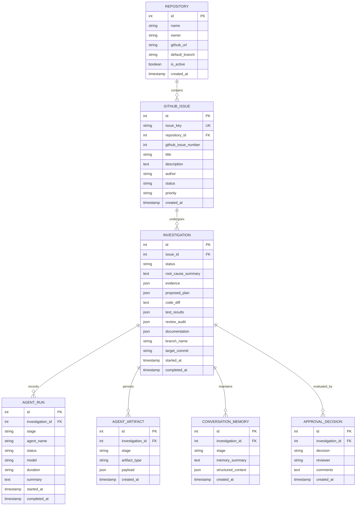

# BugBunny — System Architecture Specification

## 1. System Overview

**BugBunny** is an autonomous, web-based multi-agent software engineering platform. It transforms GitHub issues into verified, implementation-ready code changes with minimal developer overhead.

The platform is designed around strict separation of concerns across three core architectural tiers:
1. **Frontend Tier (Presentation & Interaction)**: Next.js 16 App Router interface providing high-density developer observability, real-time investigation progress, interactive unified diff review, and approval controls.
2. **Backend Gateway Tier (API & Orchestration)**: FastAPI asynchronous service coordinating request routing, database lifecycles, and agent orchestration.
3. **Data & Execution Tier (Persistence & Sandboxing)**: PostgreSQL 16 persistence for issue metadata and run telemetry, coupled with ephemeral Git worktrees for isolated test execution.

---

## 2. High-Level Architecture Diagram

```mermaid
flowchart TD
    subgraph ClientLayer [Client & Developer Interface]
        Dev([Developer / Maintainer]) -->|Browse & Review| UI[Next.js 16 App Router UI]
        Dev -->|Approve for Export| HumanGate{Human Approval Gate}
    end

    subgraph GatewayLayer [API & Orchestration Gateway]
        UI -->|REST / Async JSON| BE[FastAPI Backend Gateway]
        BE --> Auth[CORS & Security Middleware]
        BE --> ORCH[Orchestration Coordinator Service]
    end

    subgraph DataLayer [PostgreSQL 16 Persistence]
        BE <-->|SQLAlchemy 2.0 / asyncpg| DB[(PostgreSQL 16)]
        DB --- T1[(issues)]
        DB --- T2[(investigations)]
        DB --- T3[(agent_runs)]
        DB --- T4[(agent_artifacts)]
        DB --- T5[(conversation_memories)]
        DB --- T6[(approval_decisions)]
    end

    subgraph AgentPipeline [Six-Stage Multi-Agent Workflow (OpenAI Agents SDK)]
        ORCH --> A1[1. Requirements Analyst]
        A1 -->|Handoff: RequirementsAnalysis| A2[2. Codebase Investigator]
        A2 -->|Handoff: InvestigationEvidence| A3[3. Solution Planner]
        A3 -->|Handoff: ImplementationPlan| A4[4. Patch Engineer]
        A4 -->|Handoff: PatchProposal| A5[5. Test Runner]
        A5 -->|Handoff: TestReport| A6[6. Code Reviewer & Doc Agent]
        A6 -->|Handoff: CodeReviewReport + DocUpdate| GateState[Investigation: awaiting_approval]
    end

    subgraph SafeToolsSandbox [Safe Sandboxed Tooling Layer]
        A1 -.-> T_ctx[get_issue_context]
        A2 -.-> T_srch[search_codebase]
        A2 -.-> T_read[read_file_excerpt]
        A3 -.-> T_mem[get_investigation_memory]
        A4 -.-> T_prop[create_patch_proposal]
        A5 -.-> T_test[run_test_command (allowlist/demo)]
        A6 -.-> T_art[save_agent_artifact]
    end

    GateState --> HumanGate
    HumanGate -->|Approved| ApprovedExport[Status: approved_for_export]
    HumanGate -->|Rejected| RejectedState[Status: rejected]
```

---

## 3. Multi-Agent Pipeline & Specialist Personas

The BugBunny multi-agent pipeline is built on the **OpenAI Agents SDK for Python** with deterministic offline **Demo Mode** fallback. Each agent operates with strict Pydantic output contracts, dedicated safe tools, and zero authority to mutate source code or write to Git.

### 3.1 Agent Handoff Workflow Diagram

```mermaid
sequenceDiagram
    autonumber
    actor Dev as Developer / User
    participant API as FastAPI API
    participant Orch as Orchestrator Service
    participant A1 as Requirements Analyst
    participant A2 as Codebase Investigator
    participant A3 as Solution Planner
    participant A4 as Patch Engineer
    participant A5 as Test Runner
    participant A6 as Code Reviewer & Doc Agent
    participant DB as PostgreSQL (Runs & Artifacts)
    participant Gate as Human Approval Gate

    Dev->>API: POST /api/v1/issues/{id}/investigations
    API->>Orch: run_investigation_workflow(issue_id)
    
    rect rgb(20, 24, 38)
        Note over Orch,A1: Stage 1: Requirements Analysis
        Orch->>A1: run(get_issue_context)
        A1-->>Orch: RequirementsAnalysis (Pydantic)
        Orch->>DB: Persist AgentRun, AgentArtifact, Memory
    end

    rect rgb(20, 24, 38)
        Note over Orch,A2: Stage 2: Codebase Investigation
        Orch->>A2: run(search_codebase, read_file_excerpt)
        A2-->>Orch: InvestigationEvidence (Pydantic)
        Orch->>DB: Persist AgentRun, AgentArtifact, Memory
    end

    rect rgb(20, 24, 38)
        Note over Orch,A3: Stage 3: Solution Planning
        Orch->>A3: run(get_investigation_memory)
        A3-->>Orch: ImplementationPlan (Pydantic)
        Orch->>DB: Persist AgentRun, AgentArtifact, Memory
    end

    rect rgb(20, 24, 38)
        Note over Orch,A4: Stage 4: Patch Synthesis (Audit Artifact Only)
        Orch->>A4: run(create_patch_proposal)
        A4-->>Orch: PatchProposal (Pydantic Unified Diff)
        Orch->>DB: Persist AgentRun, AgentArtifact, Memory
    end

    rect rgb(20, 24, 38)
        Note over Orch,A5: Stage 5: Regression & Unit Test Validation
        Orch->>A5: run(run_test_command)
        A5-->>Orch: TestReport (Pydantic)
        Orch->>DB: Persist AgentRun, AgentArtifact, Memory
    end

    rect rgb(20, 24, 38)
        Note over Orch,A6: Stage 6: Code Review & Documentation
        Orch->>A6: run(save_agent_artifact)
        A6-->>Orch: CodeReviewReport + DocumentationUpdate (Pydantic)
        Orch->>DB: Persist AgentRun, AgentArtifact, Memory
    end

    Orch->>DB: Update Investigation (status: awaiting_approval)
    Orch-->>API: Full Investigation with AgentRuns & Artifacts
    API-->>Dev: Investigation Ready for Human Review

    rect rgb(30, 20, 40)
        Note over Dev,Gate: Stage 7: Human Approval Gate
        Dev->>API: POST /api/v1/investigations/{id}/decision (decision="approve")
        API->>DB: Record ApprovalDecision, transition to approved_for_export
        API-->>Dev: 200 OK (Status: approved_for_export)
    end
```



### 3.2 Specialist Agents and Contracts

| Stage | Agent Persona | Structured Output Schema | Assigned Tools | Security Boundary |
| :--- | :--- | :--- | :--- | :--- |
| **1. Requirements** | `RequirementsAnalystAgent` | `RequirementsAnalysis` | `get_issue_context`, `save_agent_artifact` | Read-only issue context |
| **2. Investigation** | `CodebaseInvestigatorAgent` | `InvestigationEvidence` | `search_codebase`, `read_file_excerpt`, `get_investigation_memory` | Safe path sandboxed file inspection |
| **3. Planning** | `SolutionPlannerAgent` | `ImplementationPlan` | `get_investigation_memory`, `save_agent_artifact` | Non-destructive plan synthesis |
| **4. Patch Engineer** | `PatchEngineerAgent` | `PatchProposal` | `create_patch_proposal`, `read_file_excerpt` | **Artifact only**; zero write to disk/git |
| **5. Test Runner** | `TestRunnerAgent` | `TestReport` | `run_test_command`, `get_investigation_memory` | Whitelisted test commands / demo simulation |
| **6. Code Reviewer** | `CodeReviewerAgent` | `CodeReviewReport`, `DocumentationUpdate` | `save_agent_artifact`, `get_investigation_memory` | Read-only audit & changelog authoring |
| **7. Human Gate** | Human Developer Reviewer | `ApprovalDecision` | UI Decision Action (`POST /decision`) | Marks `approved_for_export`; no auto-merge |

---

## 4. Sandbox Isolation & Workspace Execution Model

Security and immutability are primary architectural constraints. Agent code execution is isolated using ephemeral workspaces:

1. **Host Immutability**: The primary working directory is never mutated directly during agent reasoning.
2. **Isolated Worktrees**: When an investigation starts, a detached Git worktree is spawned in `/tmp/bugbunny_workspaces/{investigation_id}`:
   ```bash
   git worktree add /tmp/bugbunny_workspaces/inv-101 -b bugbunny/pp-101-investigation HEAD
   ```
3. **Execution Boundaries**: The **Testing Agent** runs test runners (`pytest`, `npm test`) inside this ephemeral directory. Network access is restricted to package cache mirrors.
4. **Cleanup**: Upon investigation completion, worktrees are pruned, leaving only the stored diff and database telemetry records.

---

## 5. Domain Models & Database Schema

BugBunny models the software remediation lifecycle through seven core entities in PostgreSQL:



---

## 6. Implementation Status Matrix

| Component / Layer | Implementation Status | Notes |
| :--- | :--- | :--- |
| **Frontend Shell & Layout** | :white_check_mark: Available Now | Next.js 16 App Router, dark theme, responsive navigation |
| **Issue List & Detail Pages** | :white_check_mark: Available Now | `/` overview, `/issues` table, `/issues/PP-101` investigation view with interactive runner |
| **Backend API Gateway** | :white_check_mark: Available Now | FastAPI, `/health`, `/api/v1/issues`, `/api/v1/investigations` |
| **Database & Migrations** | :white_check_mark: Available Now | PostgreSQL 16, SQLAlchemy 2.0 async, Alembic migrations |
| **Database Seeder & Demo Data** | :white_check_mark: Available Now | Seeds 6 issues including `PP-101` with full pipeline trace |
| **Unit & Integration Tests** | :white_check_mark: Available Now | 39/39 pytest tests passing across schemas, tools, orchestrator, and endpoints |
| **OpenAI Agents SDK Layer** | :white_check_mark: Available Now | 6-agent sequential pipeline with Runner and explicit stage handoffs |
| **Gemini Provider Abstraction** | :white_check_mark: Available Now | Provider abstraction with strict offline Demo Mode fallback |
| **Safe Sandbox Tools** | :white_check_mark: Available Now | 7 typed safe tools with path traversal guards and immutable patch proposals |
| **Human Approval Gate** | :white_check_mark: Available Now | Human reviewer decision transitions to `approved_for_export` |
| **Live GitHub Webhooks & Apps** | :white_circle: Planned Roadmap | Scheduled for Milestone 6 |
| **Empirical Evaluation Benchmark**| :white_circle: Planned Roadmap | Scheduled for Milestone 7 |
