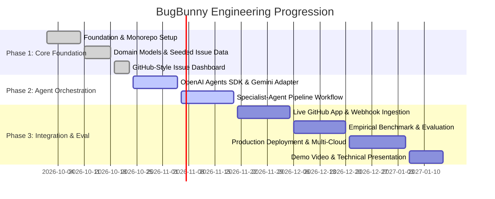

# BugBunny — Engineering Roadmap

This document outlines the phased development roadmap for **BugBunny**. Milestones track our progression from initial monorepo architecture and schema foundations to full multi-agent orchestration, GitHub webhook automation, and empirical evaluation.

---

## Roadmap Overview & Progress Tracker

---

## Detailed Milestone Specifications

### Milestone 1: Foundation :white_check_mark: Completed
- [x] Configure monorepo structure: `frontend/`, `backend/`, `infra/`, `docs/`.
- [x] Setup Next.js 16 (App Router) with React 19, TypeScript, and Tailwind CSS.
- [x] Setup FastAPI asynchronous backend gateway with Uvicorn.
- [x] Configure PostgreSQL 16 Alpine container via Docker Compose.
- [x] Initialize Alembic database migration environment with async SQLAlchemy 2.0 driver.
- [x] Setup Pytest test suite with `httpx.AsyncClient` and asynchronous test harness.
- [x] Implement root health check endpoints (`GET /health`, `GET /api/health`).

### Milestone 2: Domain Models and Seeded Issue Data :white_check_mark: Completed
- [x] Define declarative SQLAlchemy models:
  - `Repository`: Metadata, GitHub URL, default branch, active status.
  - `GitHubIssue`: Issue keys, repository linkage, issue numbers, descriptions, author, priority.
  - `Investigation`: Plan, evidence items, generated diffs, test summaries, PR documentation.
  - `AgentRun`: Individual pipeline execution traces, durations, models, and outputs.
  - `ApprovalDecision`: Developer sign-off records, review comments, approval status.
- [x] Author baseline Alembic migration script (`001_initial_schema.py`).
- [x] Implement database seeder (`seed_demo_data`) populating demo repository (`demo-ecommerce-app`) and issue `PP-101`.
- [x] Implement core REST endpoints: `GET /api/issues`, `GET /api/issues/{issue_id}`, `POST /api/issues/{issue_id}/investigations`, `GET /api/investigations/{investigation_id}`.
- [x] Comprehensive backend test suite (11/11 tests passing).

### Milestone 3: GitHub-Style Issue Dashboard :white_check_mark: Completed
- [x] Dark-theme developer UI inspired by GitHub's density, accessible contrast, and restrained motion.
- [x] Overview page (`/`) displaying system status, pipeline metrics, and active repositories.
- [x] Issues table view (`/issues`) with priority pills, status badges, and quick search.
- [x] Interactive investigation view (`/issues/PP-101`):
  - Agent timeline: Requirements Analysis → Bug Investigation → Solution Planner → Coding Assistant → Testing → Code Review → Documentation.
  - Root cause synthesis and evidence log viewer.
  - Implementation plan step cards with risk level assessment.
  - Syntax-highlighted unified diff (`git diff`) inspector.
  - Pytest execution output cards with regression coverage delta.
  - Code review audit checklist (Security, Performance, Style).
  - Pull request draft with markdown copy capability.
- [x] Client-side mock state and responsive mobile/desktop layouts.

### Milestone 4: OpenAI Agents SDK & Gemini Provider Integration :arrows_counterclockwise: In Development
- [ ] Install and configure `@openai/agents-sdk` / Python Agents SDK runtime.
- [ ] Author custom LLM model adapter for Google Gemini 1.5 Pro and Gemini 1.5 Flash.
- [ ] Implement structured output validation using Pydantic schemas for agent handoffs.
- [ ] Implement token budget tracking and streaming token consumption telemetry.
- [ ] Unit test agent function calling and structured error recovery.

### Milestone 5: Specialist-Agent Workflow Pipeline :arrows_counterclockwise: In Development
- [ ] Connect the 7 specialized agent personas:
  1. **Requirements Analyst**: Parses issue text into acceptance criteria.
  2. **Codebase Investigator**: AST symbol retrieval and call-graph search tools.
  3. **Solution Planner**: Synthesizes atomic multi-file modification steps.
  4. **Coding Assistant**: Emits valid unified diffs matching project conventions.
  5. **Testing Agent**: Runs sandboxed pytest/npm test runners and captures traces.
  6. **Code Reviewer**: Audits patches against security and style rules.
  7. **Documentation Writer**: Generates release notes and PR summaries.
- [ ] Implement iterative feedback loop: Test failures auto-route back to Coding Assistant (max 3 cycles).
- [ ] Implement persistent run trace recording into `agent_runs` table.

### Milestone 6: GitHub Integration :white_circle: Planned
- [ ] Create GitHub App manifest with issue and pull request read/write permissions.
- [ ] Implement webhook receiver for `issues.opened`, `issues.labeled`, and `issue_comment.created`.
- [ ] Implement branch creation (`bugbunny/{issue_key}-fix`) and automated Git commit authoring.
- [ ] Implement automated Pull Request creation with formatted Markdown body and test attachments.

### Milestone 7: Testing and Empirical Evaluation :white_circle: Planned
- [ ] Assemble benchmark dataset of 50 real-world open-source bugs (SWE-bench style evaluation).
- [ ] Measure retrieval precision/recall for Codebase Investigator against ground-truth modified files.
- [ ] Benchmark First-Pass Patch Success Rate and Multi-Turn Convergence Rate.
- [ ] Measure latency and inference cost per resolved issue across Gemini 1.5 Pro vs. Flash.

### Milestone 8: Deployment & Infrastructure :white_circle: Planned
- [ ] Production multi-stage Dockerfiles (`backend/Dockerfile`, `frontend/Dockerfile`).
- [ ] Root `docker-compose.yml` for unified single-command deployment.
- [ ] Cloud deployment guides (Render backend, Vercel frontend, Neon serverless Postgres).
- [ ] Automated CI/CD pipeline using GitHub Actions (Lint, Test, Typecheck, Docker Build).

### Milestone 9: Demo Video & Portfolio Presentation :white_circle: Planned
- [ ] Record a 3-minute high-resolution technical walkthrough of an end-to-end issue resolution.
- [ ] Publish interactive live demo instance with sanitized public repositories.
- [ ] Author architectural deep-dive case study and portfolio presentation deck.
